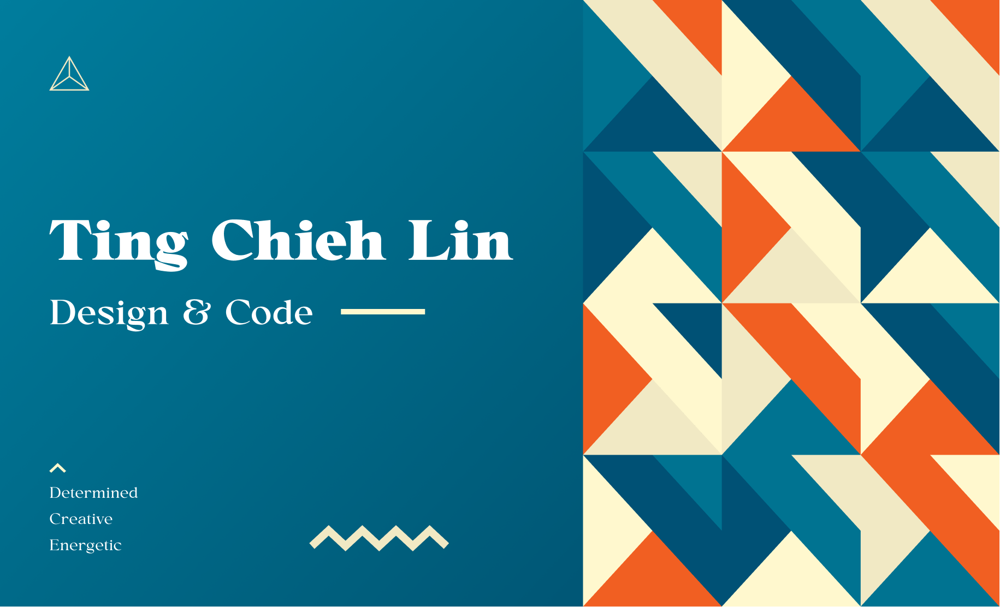
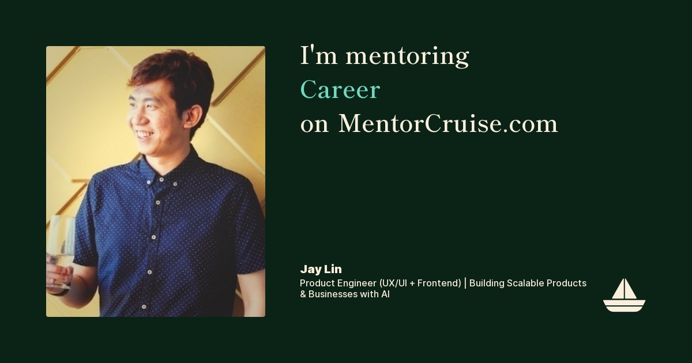

# Product Engineer | AI & Creative Technology

I’m a Product Engineer focused on building AI-powered products and creative experiences. I combine full-stack development, UX/UI design, and product thinking to turn ideas into useful, intuitive tools. I start with user needs and develop solutions through prototyping and feedback.

I’m graduating with a Master of Computer Science and am especially interested in AI-powered creation and human–AI interaction. I enjoy exploring how AI can help people create, express ideas, and solve problems, alongside mentoring and collaborating across design and technology.

## 📖 Table of Contents

- [Selected Projects](#-selected-projects)
- [Projects](#-projects)
- [My Portfolio](#-my-portfolio)
- [Contact Me](#-contact-me)
- [Mentoring](#-mentoring)
- [Support My Work](#-support-my-work)

## ✨ Selected Projects

### [AgentsVille Trip Planner](https://github.com/TingChiehLin/agentsville_planner)

An AI travel-planning project that generates and refines itineraries using an LLM and simulated weather and activity tools. It explores how agents can combine structured outputs and tool use to support a practical planning task.

### [Mood Music Recommender](https://github.com/TingChiehLin/ai-mood-music-recommender)

An AI music recommendation project exploring how mood input can guide music discovery. It connects a creative product concept with a web interface and an AI backend.

**Technologies:** Next.js, React, TypeScript, Python, Flask, and OpenAI.

### [Product Feedback](https://github.com/TingChiehLin/product-feedback-app)

A full-stack project centred on product feedback.

## 🛠 Projects

### AI, Data & Automation

- [AgentsVille Trip Planner](https://github.com/TingChiehLin/agentsville_planner)
- [Breed Image Classifier](https://github.com/TingChiehLin/image_classifier_breed)

### Full-Stack Development

- [Mood Music Recommender](https://github.com/TingChiehLin/ai-mood-music-recommender)
- [Product Feedback](https://github.com/TingChiehLin/product-feedback-app)

### Creative Technology, XR & UX/UI

- [Animal Village](https://tingchiehlin.com/animalvillage)
- [Royal Botanic Gardens Victoria App](https://tingchiehlin.com/royalbotanicgarden)

### Frontend Development

- [The News](https://github.com/TingChiehLin/the-news)
- [Top Movies](https://github.com/TingChiehLin/top-movies)
- [Crypto Search](https://github.com/TingChiehLin/crypto-search)
- [SPLI TTER](https://github.com/TingChiehLin/spli-tter-ui)

### React Native

- [MIXR](https://github.com/TingChiehLin/mixr)
- [Mobile Flashcards](https://github.com/TingChiehLin/Mobile-Flashcards)

### Other Projects

- [C-3PO](https://youtu.be/eKKtbI5PHLo?si=mSS_Glo_Qtpiwzwp)
- [Yummy CLI](https://github.com/TingChiehLin/CLI)
- [Image Processing API](https://github.com/TingChiehLin/image-processing-api)
- [Name Sorter](https://github.com/TingChiehLin/name-sorter)

## 💼 My Portfolio

Explore my development work, design projects, and creative storytelling.

- [Personal Website](https://tingchiehlin.com/)
- [Design Portfolio](https://www.behance.net/jaylinxr)
- [Devpost](https://devpost.com/cooloojayoo)
- [Little Life Anime Stories](https://youtube.com/@littlelifeanimestories?si=Ac7Mn0kqWQ4xA-Av)

## 📬 Contact Me

Connect with me to discuss opportunities, projects, or collaborations across AI, product development, and creative technology.

## 🧑🏼‍🏫 Mentoring

I enjoy sharing knowledge and helping others grow through design and technology. Find my mentoring profile on MentorCruise.

## 💛 Support My Work

If you enjoy my projects and creative work, you can support me with a coffee.

